<!--
  Profile README for github.com/INFINITQ.
  scripts/build_cards.py draws every card from profile.config.json, once per GitHub theme,
  and <picture> shows the one that matches the reader's. Live cards come from the `output`
  branch, redrawn daily by .github/workflows/profile.yml.
  A linked image wraps its whole <picture> in the <a>: github.com only swaps the theme
  when the  sits directly inside the <picture>.
-->

  <picture>
    <source media="(prefers-color-scheme: dark)" srcset="https://raw.githubusercontent.com/INFINITQ/INFINITQ/output/hero-dark.svg">
    
  </picture>

I build fast, private, native apps and the ML behind smarter software: things that sit between systems programming and AI. Off the keyboard: F1, the gym and the bike.

[LinkedIn](https://www.linkedin.com/in/abhishek-pareek-/) &nbsp;·&nbsp; [Email](mailto:abhishekpareekjp17@gmail.com) &nbsp;·&nbsp; [areth.app](https://www.areth.app)

### Experience

**Founder** · [Areth](https://www.areth.app) · 2026 – now 
A context-aware intelligence layer for your desktop, in stealth.

**AI Dataset Engineer** · Shipd by Datacurve · Jun 2024 – now 
Training data for algorithms and software-engineering tasks. Checking pipelines in C++ and Python over 300+ problem sets; model reasoning up 20%+.

**Software Engineering Intern** · LinuxWorld Informatics · May – Jul 2025 
Shipped three GenAI backend services (Python, REST) on Linux and AWS, with Docker and Jenkins CI/CD.

**B.Tech, Computer Science** · BIT Mesra · 2023 – 2027 
Microsoft Learn Student Ambassador (Graphics co-lead) · Techverse senior core team · Technical Committee senior coordinator.

### Projects

  <a href="https://github.com/INFINITQ/Lathe"><picture><source media="(prefers-color-scheme: dark)" srcset="https://raw.githubusercontent.com/INFINITQ/Lathe/main/docs/screenshots/m9-dark.png"></picture></a>
   
  Lathe, my native code editor for Windows 11. No VS Code inside.

  <a href="https://github.com/INFINITQ/Lathe"><picture><source media="(prefers-color-scheme: dark)" srcset="https://raw.githubusercontent.com/INFINITQ/INFINITQ/output/project-lathe-dark.svg"></picture></a>
  <a href="https://github.com/INFINITQ/Hearth"><picture><source media="(prefers-color-scheme: dark)" srcset="https://raw.githubusercontent.com/INFINITQ/INFINITQ/output/project-hearth-dark.svg"></picture></a>
  <a href="https://github.com/INFINITQ/EverydayApps"><picture><source media="(prefers-color-scheme: dark)" srcset="https://raw.githubusercontent.com/INFINITQ/INFINITQ/output/project-folio-dark.svg"></picture></a>
  <a href="https://github.com/INFINITQ/retailStoreIntelligence"><picture><source media="(prefers-color-scheme: dark)" srcset="https://raw.githubusercontent.com/INFINITQ/INFINITQ/output/project-store-dark.svg"></picture></a>

More projects

 

- [web-browser](https://github.com/INFINITQ/web-browser) · A tabbed browser with bookmarks, history, downloads, ad-blocking and PDF export. Python, PyQt5, QtWebEngine.
- [Smart_air_Whiteboard](https://github.com/INFINITQ/Smart_air_Whiteboard) · Draw in the air with hand gestures: one finger draws, two clear, three save, four lock the PC. Python, OpenCV, CVZone.
- [message-it-Out](https://github.com/INFINITQ/message-it-Out) · Gemini drafts a reply that fits your mood and the relationship, then sends it as an SMS. Python, Streamlit, Gemini.
- [jenkinsautomation](https://github.com/INFINITQ/jenkinsautomation) · An F1 fan site (Verstappen, Red Bull) with tests and a Dockerfile, built by Jenkins on every push. Python, Flask, Docker, Jenkins.

### Applied ML

  <picture>
    <source media="(prefers-color-scheme: dark)" srcset="https://raw.githubusercontent.com/INFINITQ/INFINITQ/main/assets/ml-season-dark.svg">
    
  </picture>

Every challenge is a fresh dataset, a metric and a GPU budget. Backbones run from ViT, ConvNeXt, DINOv2/v3, CLIP and SigLIP to Qwen3, T5, NLLB and Whisper, fine-tuned with LoRA and trained on Google Cloud, RunPod, Modal and my own RTX 5070.

### Stack

**Languages** · Rust, TypeScript, Python, C++, C, JavaScript, Go, Bash, PowerShell 
**AI and ML** · PyTorch, timm, Hugging Face, LoRA, scikit-learn, OpenCV, llama.cpp, Gemini, Kaggle 
**Apps and web** · Tauri, React, Next.js, Tailwind CSS, Vite, Qt 
**Backend and cloud** · FastAPI, PostgreSQL, SQLite, Redis, Docker, Jenkins, GitHub Actions, Linux, AWS, Google Cloud, Cloudflare, Supabase, Vercel

### Telemetry

  <picture>
    <source media="(prefers-color-scheme: dark)" srcset="https://raw.githubusercontent.com/INFINITQ/INFINITQ/output/telemetry-dark.svg">
    
  </picture>

  <picture>
    <source media="(prefers-color-scheme: dark)" srcset="https://raw.githubusercontent.com/INFINITQ/INFINITQ/output/languages-dark.svg">
    
  </picture>

  <picture>
    <source media="(prefers-color-scheme: dark)" srcset="https://raw.githubusercontent.com/INFINITQ/INFINITQ/output/snake-dark.svg">
    
  </picture>

  <picture>
    <source media="(prefers-color-scheme: dark)" srcset="https://raw.githubusercontent.com/INFINITQ/INFINITQ/main/assets/footer-dark.svg">
    
  </picture>

 &nbsp;Cards drawn by <a href="scripts/build_cards.py">my own script</a> and refreshed daily by a <a href=".github/workflows/profile.yml">GitHub Action</a>.
