<!--
  Profile README for github.com/INFINITQ, F1 "pit wall" edition.
  assets/*.svg are drawn by scripts/build_cards.py from profile.config.json.
  The live cards come from the `output` branch, rebuilt daily by .github/workflows/profile.yml.
-->

  

  
  
  
  

## 🏎️ Driver profile

  

I build **fast, private, native apps** and the **ML** behind smarter software: things that sit between systems programming and AI.

- 🛠️ **Desktop apps in Rust + TypeScript (Tauri):** a code editor that paints in under half a second, a local-LLM workstation and an offline Office suite.
- 🧪 **Applied ML:** 170+ challenges across vision, biology, NLP, geospatial, OCR, audio and more in my 2026 season.
- 🚀 **Founder of [Areth](https://www.areth.app):** a context-aware intelligence layer for your desktop, in stealth.
- 🎓 **Final-year B.Tech CSE at BIT Mesra** ('27) and a Microsoft Learn Student Ambassador.
- 🏁 **Off the pit wall:** F1, the gym and biking.

## 🏁 Career

| Season | Team | Highlights |
| :-- | :-- | :-- |
| 2026 → | **[Areth](https://www.areth.app)** Founder | Building a context-aware AI desktop app, in stealth |
| Jun 2024 → | **Shipd by Datacurve** AI Dataset Engineer | Training data for algorithms and software-engineering tasks; C++/Python checking pipelines over 300+ problem sets; model reasoning up 20%+ |
| May – Jul 2025 | **LinuxWorld Informatics** Software Engineering Intern | Shipped 3 GenAI backend services (Python, REST) on Linux/AWS with Docker and Jenkins CI/CD |
| 2023 – 2027 | **BIT Mesra** B.Tech, Computer Science | Microsoft Learn Student Ambassador (Graphics Co-Lead) · Techverse Senior Core Team · Technical Committee Senior Coordinator |

## 🔧 The garage

  <a href="https://github.com/INFINITQ/Lathe">
    <picture>
      <source media="(prefers-color-scheme: dark)" srcset="https://raw.githubusercontent.com/INFINITQ/Lathe/main/docs/screenshots/m9-dark.png">
      
    </picture>
  </a>
   
  <b>ONBOARD CAMERA</b> · Lathe, my native code editor for Windows 11, with no VS Code inside

  
  
  
  

<b>More from the garage</b>

 

| Project | What it does | Built with |
| :-- | :-- | :-- |
| [web-browser](https://github.com/INFINITQ/web-browser) | A tabbed browser with bookmarks, history, downloads, ad-blocking and PDF export | Python · PyQt5 · QtWebEngine |
| [Smart_air_Whiteboard](https://github.com/INFINITQ/Smart_air_Whiteboard) | Draw in the air with hand gestures: one finger draws, two clear, three save, four lock the PC | Python · OpenCV · CVZone |
| [message-it-Out](https://github.com/INFINITQ/message-it-Out) | Gemini drafts a reply that fits your mood and the relationship, then sends it as an SMS | Python · Streamlit · Gemini |
| [jenkinsautomation](https://github.com/INFINITQ/jenkinsautomation) | An F1 fan site (Verstappen, Red Bull) with tests and a Dockerfile, built by Jenkins on every push | Python · Flask · Docker · Jenkins |

## 🧪 2026 applied-ML season

  

Every challenge is a fresh dataset, a metric and a GPU budget. Backbones run from ViT, ConvNeXt, DINOv2/v3, CLIP and SigLIP to Qwen3, T5, NLLB and Whisper, fine-tuned with LoRA and trained on Google Cloud, RunPod, Modal and my own RTX 5070.

## ⚙️ Power unit

  <b>ENGINE</b> · languages 
  

  <b>AERO</b> · AI and ML 
   
  
  
  
  

  <b>CHASSIS</b> · apps and web 
  

  <b>PIT CREW</b> · backend, cloud and tools 
   
  

## 📡 Telemetry

  
  

  <picture>
    <source media="(prefers-color-scheme: dark)" srcset="https://raw.githubusercontent.com/INFINITQ/INFINITQ/output/snake-dark.svg">
    
  </picture>

  

  The cards are drawn by <a href="scripts/build_cards.py">my own script</a> and refreshed daily by a <a href=".github/workflows/profile.yml">GitHub Action</a>.

